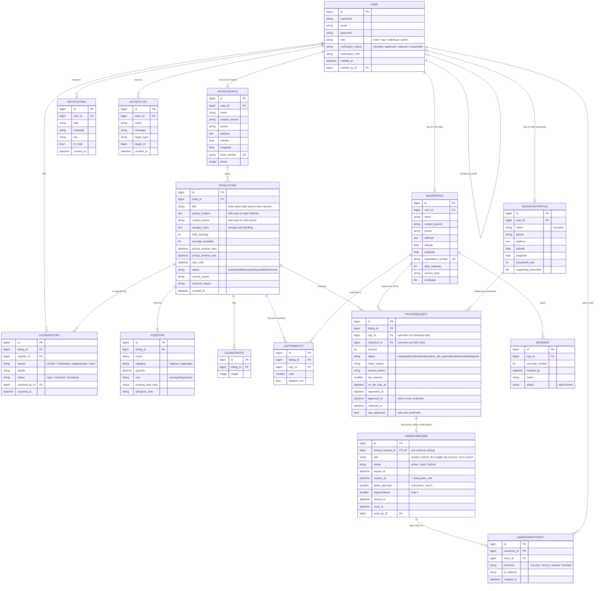

# FoodBridge — ER Diagram

## Notes

- `USER` is a single table with a `role` discriminator (hotel / ngo / admin)
  rather than separate Django auth models, so one login system serves all
  three roles.
- `HOTELPROFILE` / `NGOPROFILE` are each a strict one-to-one extension of
  `USER` — only populated for the matching role.
- Indexes are on `FOODLISTING(status, safe_until)` (for expiry sweeps and the
  NGO browse page), `PICKUPREQUEST(status)`, `NOTIFICATION(user, is_read)`,
  and `(latitude, longitude)` on both profile tables.
- A partial unique constraint on `PICKUPREQUEST(listing, ngo)` — scoped to the
  active statuses (`requested/confirmed/on_the_way`) — stops an NGO from
  holding two simultaneous open requests on the same listing, while still
  letting history accumulate (a rejected, then a fresh request, is fine).
- `HANDOVERCODE` is split out of `PICKUPREQUEST` so the security state (salt,
  counters, lock, expiry) lives in one place and the request table stays about
  the request. `HANDOVERATTEMPT` is append-only and never stores the digits typed.
