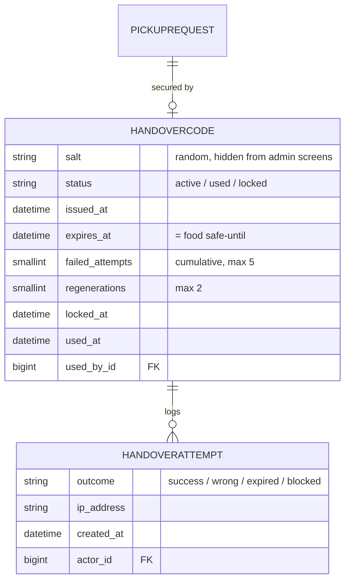
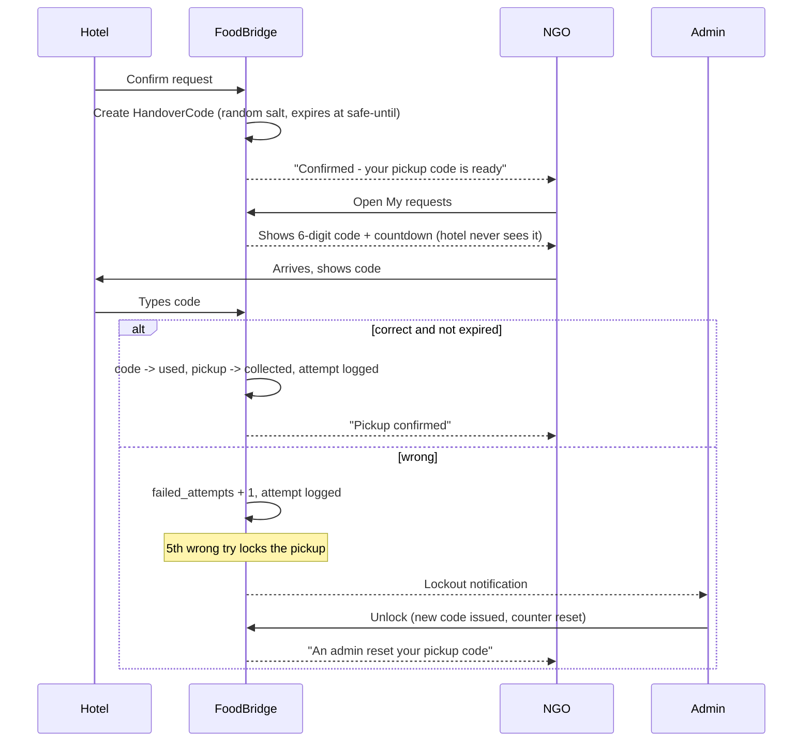

# Secure Handover Code — design document

## The problem it solves

When an NGO comes to collect food, the hotel needs proof that **this** NGO is the one
that was confirmed, and that the food is still safe to give. A shared 6-digit code
solves both: the system gives it only to the confirmed recipient (NGO or individual), the NGO says or shows it
at the counter, and the hotel types it in. If it matches, the pickup is recorded as
collected.

## Goals (what the feature guarantees)

| # | Goal | How it is enforced | Where |
|---|------|--------------------|-------|
| G1 | Only the confirmed recipient can see the code | Code is rendered only on the NGO's *My requests* page, filtered to that NGO's own requests; hotel pages never receive it | `views.my_requests`, `visible_code()` |
| G2 | The code is random, unguessable and never stored | 128-bit random salt from `secrets`; the 6 digits are derived with HMAC-SHA256(SECRET_KEY, pickup id, salt) when needed | `handover_service.derive_code` |
| G3 | One use, only while the food is safe, only for a live pickup | Status becomes *used* after success; code expires at the listing's `safe_until`; only *confirmed / on the way* pickups accept a code | `confirm_handover` |
| G4 | Guessing is capped | 5 wrong entries in total lock the pickup and notify all admins | `MAX_PICKUP_ATTEMPTS` |
| G5 | Everything is auditable | Each try is stored: who, when, IP address, outcome (never the digits typed) | `HandoverAttempt` |
| G6 | A lost code can be replaced safely | NGO may regenerate 2 times; the old code dies instantly; the wrong-guess counter is **not** reset | `regenerate_code` |
| G7 | Only an admin can unlock | Admin console unlock resets the counter *and* issues a brand-new code | `unlock_handover` |

## Data model



*Expired* is not a stored status: a code is expired when `now >= expires_at`, so it
can never be "forgotten" by a job that didn't run.

## How a code is generated and checked

```text
issue:    salt  = secrets.token_hex(16)                       # random, saved in DB
show:     code  = HMAC-SHA256(SECRET_KEY, "handover:<id>:<salt>")  ->  first 8 bytes  ->  mod 10^6  ->  6 digits
check:    hmac.compare_digest(typed.encode(), code.encode())  # constant time, bytes (never crashes on odd input)
```

Why not simply save a random number? A saved code sits in plain text in the database,
backups and the admin screen. With this approach the database alone is not enough to
learn a code. *Honest limits:* someone holding both the database and `SECRET_KEY`
could recompute codes, and changing `SECRET_KEY` while pickups are in flight
invalidates their codes (admins can unlock to issue new ones).

## End-to-end flow



## Screens

| Role | Page | What's new |
|------|------|-----------|
| NGO | *My requests* | Large code card, live countdown to expiry, copy button, "Get a new code (n left)", clear banners when locked or expired |
| Hotel | *Confirm handover* | Six digit boxes (auto-advance, paste, backspace), attempts meter (5 dots), live countdown, recent-attempts list; plain text box still works without JavaScript |
| Admin | *Locked pickups* | Each locked pickup with its full attempt history (time, user, IP, outcome) and an *Unlock & issue new code* button |
| Admin | Django admin | Read-only *Handover codes* and attempts; the salt is hidden |

## Rules at a glance

* Code length 6 digits · valid until the food's safe-until time · works once
* 5 wrong entries (cumulative across replacements) → locked, admins notified
* Up to 2 replacement codes per pickup; the guess counter carries over
* Approving food that is already past safe-until is refused
* Cancelling or expiring the pickup makes the code useless immediately

## Files

| File | Role |
|------|------|
| `core/models.py` | `HandoverCode`, `HandoverAttempt`, constants |
| `core/handover_service.py` | All rules (issue, show, confirm, regenerate, unlock) |
| `core/requests_service.py` | Calls `issue_code()` inside the approval transaction |
| `core/views.py` | `confirm_handover` (hotel), `my_requests`, `code_regenerate` (NGO) |
| `console/views.py` | `locked_pickups`, `unlock_pickup` (admin) |
| `core/forms.py` | `HandoverCodeForm` (exactly 6 digits) |
| `static/js/handover.js` | Digit boxes, countdown, copy button |
| `templates/core/confirm_handover.html`, `templates/partials/handover_code_card.html`, `templates/console/locked_pickups.html` | Screens |
| `core/tests/test_pickup_code.py` | 29 tests, each tagged with the goal it protects |

## Possible future work

SMS/e-mail delivery of the code, QR code instead of digits, per-IP throttling, and a
dedicated admin report of handover attempts over time.
